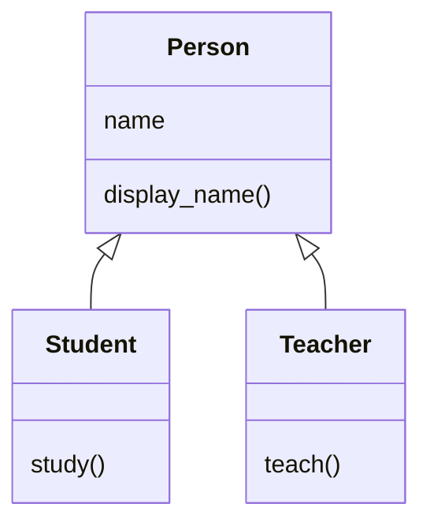

# Inheritance

A college has both students and teachers. Every student and every teacher has a name, and both need a way to display it. Writing the same name-related code separately in a `Student` class and a `Teacher` class would repeat it. **Inheritance** lets both classes share that code from one common class.

## Inheritance

> **Inheritance allows a class to reuse the methods and attributes of another class, while also defining its own behaviour.**

The two classes involved have specific names:

| Term | Also Called | Meaning |
| --- | --- | --- |
| **Parent class** | Base class, superclass | The class whose methods and attributes are reused. |
| **Child class** | Derived class, subclass | The class that reuses them. |

Inheritance represents an **"is-a" relationship**. A student **is a** person, and a teacher **is a** person, so `Student` and `Teacher` can both be child classes of a `Person` parent class.

## Creating a Child Class

A child class is created by writing the parent class name inside parentheses after the child class name.

**Syntax:**

```python
class ParentClass:
    pass

class ChildClass(ParentClass):
    pass
```

**Example:**

```python
class Person:
    def __init__(self, name):
        self.name = name

    def display_name(self):
        print("Name:", self.name)

class Student(Person):
    pass

class Teacher(Person):
    pass

student1 = Student("Ravi")
teacher1 = Teacher("Meena")

student1.display_name()
teacher1.display_name()
```

**Output:**

```
Name: Ravi
Name: Meena
```

`Student` and `Teacher` contain no code of their own, yet both work. When Python looks up a method on an object, it **first checks the object's class. If the method isn't defined there, it searches the parent class.**

- `Student` has no `__init__` method, so `Student("Ravi")` automatically runs the `__init__` method of `Person`. That method creates the `name` attribute on the new object.
- `Student` has no `display_name()` method either, so `student1.display_name()` runs the one defined in `Person`.

**Both child classes inherit the methods defined in `Person`**, so the name-related code is written only once.

**If a child class does not define its own `__init__()`, Python uses the inherited one. If the child defines its own `__init__()`, that method runs instead.** The child can still call the parent's `__init__()` using `super()`, which is covered in **The `super()` Function**.

## Adding Methods to a Child Class

A child class can also define its own methods, in addition to the ones it inherits. These methods belong only to that child class.

```python
class Person:
    def __init__(self, name):
        self.name = name

    def display_name(self):
        print("Name:", self.name)

class Student(Person):
    def study(self):
        print(self.name, "is studying")

class Teacher(Person):
    def teach(self):
        print(self.name, "is teaching")

student1 = Student("Ravi")
teacher1 = Teacher("Meena")

student1.display_name()
student1.study()
teacher1.display_name()
teacher1.teach()
```

**Output:**

```
Name: Ravi
Ravi is studying
Name: Meena
Meena is teaching
```

`study()` uses `self.name`, which is set by the inherited `__init__` method. A child class can use inherited attributes in its own methods.

The diagram shows what each class defines. The arrows point from each child class to its parent class.



**Inheritance passes behaviour from parent to child, not from child to parent.** A `Student` object can use methods defined in `Person`, but a `Person` object cannot use `study()`, because that method is defined only in `Student`. Calling it raises an **`AttributeError`**. Similarly, `teach()` belongs only to `Teacher`.

## Checking Inheritance Relationships

Python provides two built-in functions to check how objects and classes are related:

- **`isinstance(object, class)`** returns `True` if the object is an instance of the class or of any of its child classes.
- **`issubclass(class1, class2)`** returns `True` if `class1` is the same as `class2` or inherits from it.

```python
class Person:
    def __init__(self, name):
        self.name = name

class Student(Person):
    pass

student1 = Student("Ravi")

print(isinstance(student1, Student))
print(isinstance(student1, Person))
print(issubclass(Student, Person))
print(issubclass(Person, Student))
```

**Output:**

```
True
True
True
False
```

`student1` is an instance of both `Student` and `Person`, because a student **is a** person. `Student` inherits from `Person`, but `Person` does not inherit from `Student`.

Every class in Python ultimately inherits from the built-in **`object`** class, even when you don't explicitly write a parent class. That's why `isinstance(student1, object)` returns `True`.

## Further Reading

- 📎 **Official Python guide to inheritance** — https://docs.python.org/3/tutorial/classes.html#inheritance

`Student` inherits `display_name()` exactly as it is written in `Person`. Sometimes a child class needs an inherited method to behave differently, such as displaying `Student: Ravi` instead of `Name: Ravi`. In the next topic, **Method Overriding**, you'll learn how a child class can replace an inherited method with its own version.
