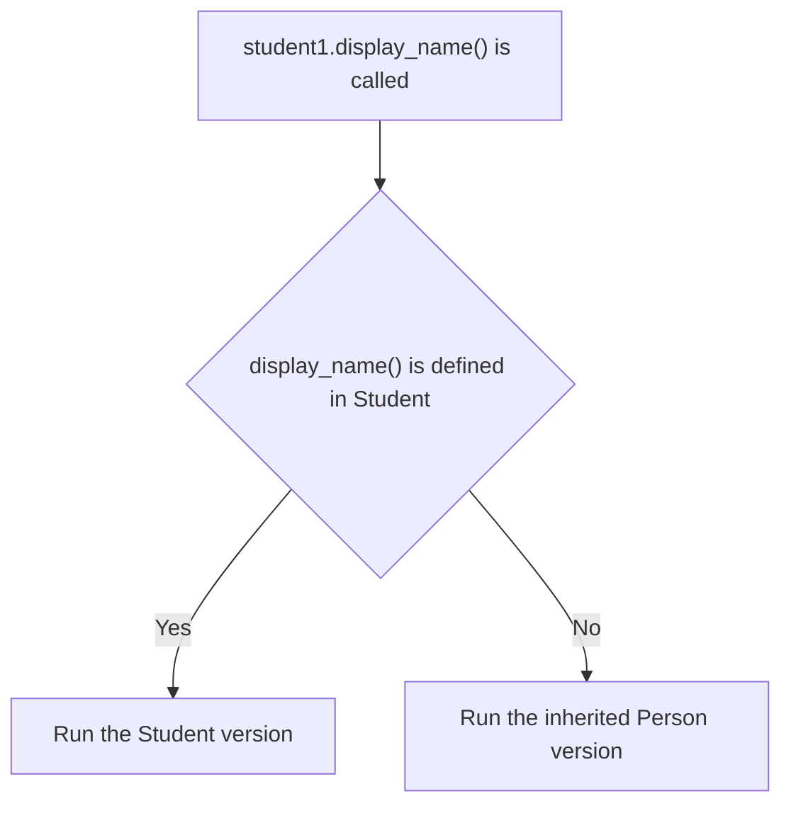

# Method Overriding

A child class inherits methods from its parent class. Most of the time, an inherited method works well for the child class. Sometimes, however, the child class needs the same action to be done in a different way.

Without method overriding, the two common options both cause problems:

- **Change the method in the parent class.** This affects every class that inherits from it.
- **Create a new method with a different name in the child class.** Code that uses these classes would need to know their different method names, even though they perform the same action.

**Method overriding** solves both problems. The child class keeps the same method name and writes its own version. The parent class stays unchanged.

## Method Overriding

> **Method overriding means writing a method in a child class with the same name as a method in its parent class. Objects of the child class then use the child's version.**

Think of a father who greets guests by saying "Namaste". His son also greets guests, but he says "Hello". Both perform the same action, **greeting**, but each does it in his own way. In the same way, a child class keeps the method's name but gives it new behaviour.

- The parent's version is called the **overridden method**.
- The child's version is called the **overriding method**.

## Overriding a Method

To override a method, write a method with the **same name** inside the child class. Different child classes can each override the same method in their own way.

```python
class Person:
    def __init__(self, name):
        self.name = name

    def display_name(self):
        print("Name:", self.name)

class Student(Person):
    def display_name(self):
        print("Student:", self.name)

class Teacher(Person):
    def display_name(self):
        print("Teacher:", self.name)

person1 = Person("Arun")
student1 = Student("Ravi")
teacher1 = Teacher("Meena")

person1.display_name()
student1.display_name()
teacher1.display_name()
```

**Output:**

```
Name: Arun
Student: Ravi
Teacher: Meena
```

When `student1.display_name()` runs, Python first looks inside the `Student` class. It finds `display_name()` there, so it runs the `Student` version. In the same way, `teacher1` runs the `Teacher` version.

If a child class does not define its own version, Python looks inside the parent class and runs the inherited version.



**Overriding does not change the parent's method.** `Person` still has its original `display_name()`, so `person1` still displays `Name: Arun`.

## Method Overriding and Polymorphism

> **Polymorphism means the same method call can behave differently for different objects.**

In the example, the same call, `display_name()`, displays three different results for `person1`, `student1` and `teacher1`.

Method overriding is **one way to achieve polymorphism**. Python chooses which version to run based on the object's class when the method is called. Because this choice is made while the program is running, polymorphism achieved through method overriding is called **runtime polymorphism**.

Polymorphism is covered in detail in the **Polymorphism** topic.

## Rules for Overriding a Method

Follow these rules when you override a method:

1. **The child class must inherit from the parent class.** Overriding happens only between a parent class and its child class. A method with the same name in an unrelated class does not override anything.
2. **The method name must match exactly.** Method names are case-sensitive, so `display_Name` and `display_name` are two different names.
3. **Keep the method compatible with how it is called.** Python does not require the overriding method to have exactly the same parameters. However, if the child method cannot accept arguments that existing code passes to the parent's method, the call may raise a **`TypeError`**.
4. **Keep the method's purpose consistent.** The child can change how the method works, but it should still fulfil the same general responsibility as the parent's method.
5. **Private methods are not overridden in the usual way.** Python renames a method whose name starts with two underscores, such as `__display()`, using **name mangling**. A child method with the same name gets a different internal name, so it does not replace the parent's method.

Breaking rule 2 by mistake is common, and Python does not warn you about it.

```python
class Person:
    def __init__(self, name):
        self.name = name

    def display_name(self):
        print("Name:", self.name)

class Student(Person):
    def display_Name(self):
        print("Student:", self.name)

student1 = Student("Ravi")
student1.display_name()
```

**Output:**

```
Name: Ravi
```

`display_Name` has a capital `N`, so it is a **new method**, not an overriding method. Calling `display_name()` still runs the inherited version from `Person`, and no error is shown.

## Overriding the `__init__` Method

`__init__` is often called a **constructor**, but in Python it is a method with a special name. When an object is created, Python calls the applicable `__init__()` method using the class's inheritance lookup order to initialise the object. If the child class defines its own `__init__()`, Python uses that version instead of automatically running the parent's version. This is why **a child class can override `__init__`**.

In some other programming languages, such as Java, constructors cannot be overridden. Python is different, because `__init__` is inherited and looked up like any other method.

### Importance of Overriding `__init__`

- **A child object often needs more data than a parent object.** A `Person` needs only a name. A `Student` needs a name and a roll number. To accept additional data when an object is created, the child class can override `__init__`.
- **The child becomes responsible for every attribute.** Once the child has its own `__init__`, the parent's `__init__` does not run automatically. The child must create every attribute the object needs, including the parent's attributes, such as `name`, unless it calls the parent's `__init__`.
- **A missing attribute breaks inherited methods.** If the child does not create `name`, the inherited `display_name()` raises an **`AttributeError`**.

```python
class Person:
    def __init__(self, name):
        self.name = name

    def display_name(self):
        print("Name:", self.name)

class Student(Person):
    def __init__(self, name, roll_number):
        self.name = name
        self.roll_number = roll_number

student1 = Student("Ravi", 101)

student1.display_name()
print(student1.roll_number)
```

**Output:**

```
Name: Ravi
101
```

`Student("Ravi", 101)` runs `Student.__init__()`, which stores `"Ravi"` in `self.name` and `101` in `self.roll_number`. The inherited `display_name()` method works, because `self.name` already exists on the object.

## Where Method Overriding Is Used

Method overriding is used whenever related classes share an action but perform it differently.

| Parent Class | Child Classes | Overridden Method |
| --- | --- | --- |
| `Account` | `SavingsAccount`, `CurrentAccount` | `calculate_interest()`, because each account type earns interest differently |
| `Shape` | `Circle`, `Rectangle` | `area()`, because each shape uses a different formula |
| `Payment` | `UPIPayment`, `CardPayment` | `pay()`, because each payment method works differently |

## Further Reading

- 📎 **Official Python guide to inheritance and overriding** — https://docs.python.org/3/tutorial/classes.html#inheritance

The `Student` class sets up `self.name` again, even though `Person` already handles it. In the next topic, **The `super()` Function**, you'll learn how to reuse the parent's `__init__()` instead of repeating this setup.
