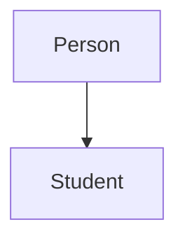
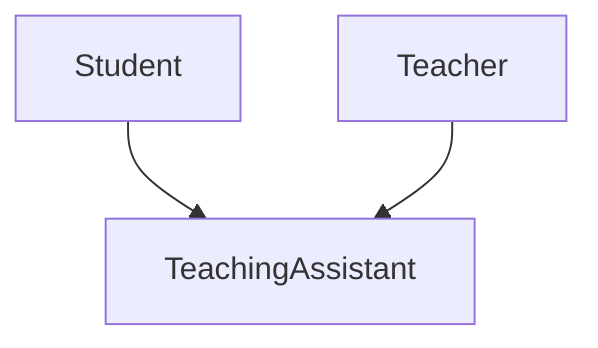
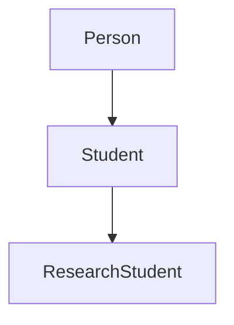
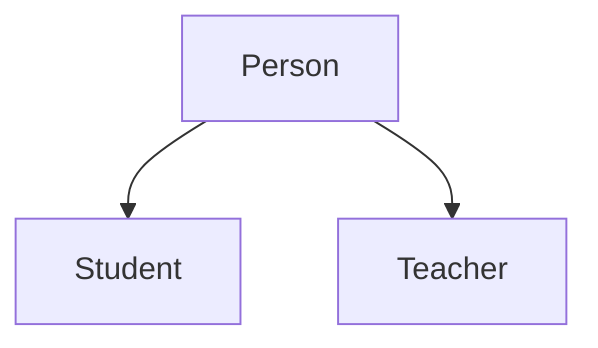
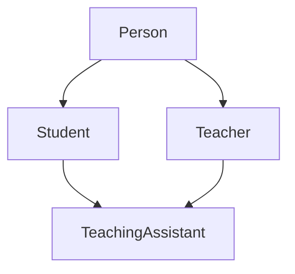

# Types of Inheritance

Classes can be connected through inheritance in several arrangements. Each arrangement has a name, based on how many parents and children are involved.

| Type | Arrangement |
| --- | --- |
| Single | One child inherits from one parent. |
| Multiple | One child inherits from two or more parents. |
| Multilevel | A child inherits from a parent, which itself inherits from another parent. |
| Hierarchical | Two or more children inherit from the same parent. |
| Hybrid | A combination of two or more of the types above. |

## Single Inheritance

> **In single inheritance, one child class inherits from one parent class.**



```python
class Person:
    def introduce(self):
        print("I am a person")

class Student(Person):
    def study(self):
        print("I am studying")

student1 = Student()
student1.introduce()
student1.study()
```

**Output:**

```
I am a person
I am studying
```

`Student` has one parent, `Person`. This is the simplest and most common type.

## Multiple Inheritance

> **In multiple inheritance, one child class inherits from two or more parent classes.**

A teaching assistant studies like a student and teaches like a teacher.



**Syntax:**

```python
class ChildClass(ParentClass1, ParentClass2):
    pass
```

```python
class Student:
    def study(self):
        print("I am studying")

class Teacher:
    def teach(self):
        print("I am teaching")

class TeachingAssistant(Student, Teacher):
    pass

assistant1 = TeachingAssistant()
assistant1.study()
assistant1.teach()
```

**Output:**

```
I am studying
I am teaching
```

The parents are separated by commas inside the brackets. `TeachingAssistant` gets the methods of both `Student` and `Teacher`.

### When Both Parents Have the Same Method

If both parents define a method with the same name, Python uses the version from the parent **listed first**.

```python
class Student:
    def introduce(self):
        print("I am a student")

class Teacher:
    def introduce(self):
        print("I am a teacher")

class TeachingAssistant(Student, Teacher):
    pass

assistant1 = TeachingAssistant()
assistant1.introduce()
```

**Output:**

```
I am a student
```

`Student` is listed before `Teacher` in `TeachingAssistant(Student, Teacher)`, so Python finds `Student`'s `introduce` first.

The order in which Python searches the classes is called the **Method Resolution Order (MRO)**. It can be displayed with the `mro()` method.

```python
print(TeachingAssistant.mro())
```

**Output:**

```
[<class '__main__.TeachingAssistant'>, <class '__main__.Student'>, <class '__main__.Teacher'>, <class 'object'>]
```

Python searches `TeachingAssistant`, then `Student`, then `Teacher`. The last class, `object`, is the built-in class that every Python class inherits from automatically.

## Multilevel Inheritance

> **In multilevel inheritance, a child class inherits from a parent class, which itself inherits from another class. The classes form a chain.**



```python
class Person:
    def introduce(self):
        print("I am a person")

class Student(Person):
    def study(self):
        print("I am studying")

class ResearchStudent(Student):
    def research(self):
        print("I am doing research")

scholar1 = ResearchStudent()
scholar1.introduce()
scholar1.study()
scholar1.research()
```

**Output:**

```
I am a person
I am studying
I am doing research
```

`ResearchStudent` inherits from `Student`, and `Student` inherits from `Person`. A `ResearchStudent` object therefore has the methods of all three classes.

## Hierarchical Inheritance

> **In hierarchical inheritance, two or more child classes inherit from the same parent class.**



```python
class Person:
    def introduce(self):
        print("I am a person")

class Student(Person):
    def study(self):
        print("I am studying")

class Teacher(Person):
    def teach(self):
        print("I am teaching")

student1 = Student()
teacher1 = Teacher()

student1.introduce()
student1.study()
teacher1.introduce()
teacher1.teach()
```

**Output:**

```
I am a person
I am studying
I am a person
I am teaching
```

`Student` and `Teacher` share the `introduce` method from `Person`, and each adds its own method.

## Hybrid Inheritance

> **Hybrid inheritance is a combination of two or more types of inheritance in one set of classes.**



```python
class Person:
    def introduce(self):
        print("I am a person")

class Student(Person):
    def study(self):
        print("I am studying")

class Teacher(Person):
    def teach(self):
        print("I am teaching")

class TeachingAssistant(Student, Teacher):
    pass

assistant1 = TeachingAssistant()
assistant1.introduce()
assistant1.study()
assistant1.teach()
```

**Output:**

```
I am a person
I am studying
I am teaching
```

`Student` and `Teacher` inheriting from `Person` is hierarchical inheritance. `TeachingAssistant` inheriting from both `Student` and `Teacher` is multiple inheritance. Together they form hybrid inheritance. No new syntax is needed; hybrid inheritance is only a name for this combined arrangement.

## Further Reading

- 📎 **Official Python guide to multiple inheritance** — https://docs.python.org/3/tutorial/classes.html#multiple-inheritance

In every arrangement, child classes can override the methods they inherit, so the same method call can behave differently for different objects. In the next topic, **Polymorphism**, you'll learn how one method name can work across many classes.
