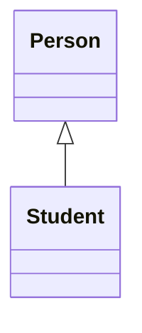
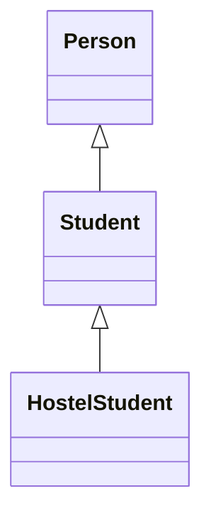
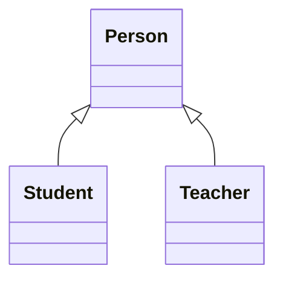
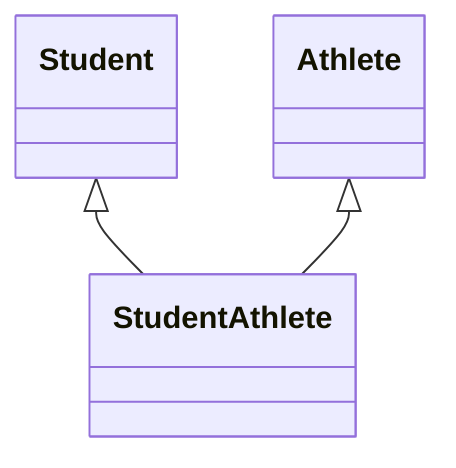
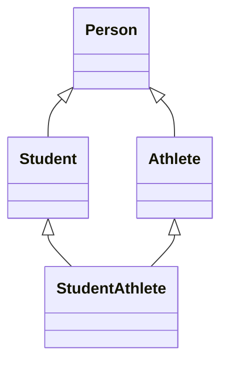

# Types of Inheritance

Classes in a program can be connected in different ways. A class may inherit from one class, from several classes, or from a class that itself inherits from another class. Each way of connecting classes is a **type of inheritance**.

Knowing these types helps you choose the right structure for your classes. It also helps you understand which method Python runs when many classes are connected.

## Types of Inheritance

Inheritance is commonly explained using five patterns. Python supports all five, including combinations of these patterns.

| Type | How the Classes Are Connected |
| --- | --- |
| **Single** | One child class inherits from one parent class. |
| **Multilevel** | A class inherits from a child class, forming a chain. |
| **Hierarchical** | Many child classes inherit from one parent class. |
| **Multiple** | One child class inherits from more than one parent class. |
| **Hybrid** | A combination of two or more of the above types. |

In the diagrams below, each arrow points from a child class to its parent class.

## Single Inheritance

> **Single inheritance means one child class inherits from one parent class.**



```python
class Person:
    def speak(self):
        print("I am a person")

class Student(Person):
    def study(self):
        print("I am studying")

student1 = Student()
student1.speak()
student1.study()
```

**Output:**

```
I am a person
I am studying
```

`Student` has its own method, `study()`, and also uses `speak()` inherited from `Person`.

## Multilevel Inheritance

> **Multilevel inheritance means a class inherits from a child class, forming a chain of classes.**



```python
class Person:
    def speak(self):
        print("I am a person")

class Student(Person):
    def study(self):
        print("I am studying")

class HostelStudent(Student):
    def stay(self):
        print("I stay in the hostel")

student1 = HostelStudent()
student1.speak()
student1.study()
student1.stay()
```

**Output:**

```
I am a person
I am studying
I stay in the hostel
```

`HostelStudent` inherits from `Student`, and `Student` inherits from `Person`. So a `HostelStudent` object can use the methods of **all three classes** in the chain.

## Hierarchical Inheritance

> **Hierarchical inheritance means many child classes inherit from the same parent class.**



```python
class Person:
    def speak(self):
        print("I am a person")

class Student(Person):
    def study(self):
        print("I am studying")

class Teacher(Person):
    def teach(self):
        print("I am teaching")

student1 = Student()
teacher1 = Teacher()

student1.speak()
student1.study()
teacher1.speak()
teacher1.teach()
```

**Output:**

```
I am a person
I am studying
I am a person
I am teaching
```

`Student` and `Teacher` both inherit `speak()` from `Person`. Each child class also has its own method. The two child classes do not share methods with each other.

## Multiple Inheritance

> **Multiple inheritance means one child class inherits from more than one parent class.**

The parent classes are written inside the brackets, separated by commas: `class ChildClass(Parent1, Parent2):`.



```python
class Student:
    def study(self):
        print("I am studying")

class Athlete:
    def play(self):
        print("I am playing")

class StudentAthlete(Student, Athlete):
    pass

player1 = StudentAthlete()
player1.study()
player1.play()
```

**Output:**

```
I am studying
I am playing
```

`StudentAthlete` has no code of its own, but it gets `study()` from `Student` and `play()` from `Athlete`.

Unlike Python, Java does not allow a class to extend more than one class, although it can implement multiple interfaces. **Python allows a class to inherit from multiple classes.**

## Hybrid Inheritance

> **Hybrid inheritance means a combination of two or more types of inheritance.**

In this example, `Student` and `Athlete` both inherit from `Person`, which is hierarchical inheritance. `StudentAthlete` then inherits from both `Student` and `Athlete`, which is multiple inheritance. The classes form a **diamond shape**.



```python
class Person:
    def speak(self):
        print("I am a person")

class Student(Person):
    def speak(self):
        print("I am a student")

class Athlete(Person):
    def speak(self):
        print("I am an athlete")

class StudentAthlete(Student, Athlete):
    pass

player1 = StudentAthlete()
player1.speak()
```

**Output:**

```
I am a student
```

`Person`, `Student` and `Athlete` all define `speak()`. Since `StudentAthlete` inherits from both `Student` and `Athlete`, Python needs a clear rule to decide which version to run. This diamond-shaped inheritance structure illustrates the **diamond problem**.

Python uses the **method resolution order (MRO)** to determine which class to search first when multiple classes define the same method.

## Method Resolution Order

> **The method resolution order (MRO) is the order in which Python searches classes to find a method.**

For the inheritance structure in this example:

1. Python searches `StudentAthlete` first.
2. It then searches `Student`, followed by `Athlete`, because they appear in that order in the class definition.
3. It searches the shared parent, `Person`, after both child classes.
4. The built-in `object` class comes last.

Each class appears only once in this order. Python uses rules called the **C3 method resolution algorithm** to determine the MRO, including in more complex inheritance structures.

You can display a class's MRO using its `mro()` method.

```python
class Person:
    def speak(self):
        print("I am a person")

class Student(Person):
    def speak(self):
        print("I am a student")

class Athlete(Person):
    def speak(self):
        print("I am an athlete")

class StudentAthlete(Student, Athlete):
    pass

print(StudentAthlete.mro())
```

**Output:**

```
[<class '__main__.StudentAthlete'>, <class '__main__.Student'>, <class '__main__.Athlete'>, <class '__main__.Person'>, <class 'object'>]
```

The order is `StudentAthlete`, `Student`, `Athlete`, `Person`, `object`. You can ignore the `__main__` part for now.

When `player1.speak()` runs, Python searches in this order. `StudentAthlete` has no `speak()`, so Python moves to `Student`. `Student` has `speak()`, so Python runs it and stops searching. This is why the output is `I am a student`.

**The order of the parent classes matters.** If the class were written as `class StudentAthlete(Athlete, Student):`, Python would search `Athlete` first, and the output would be `I am an athlete`.

## `super()` with Multiple Inheritance

`super()` calls the **next class in the MRO**, which is not always the direct parent class.

```python
class Person:
    def speak(self):
        print("I am a person")

class Student(Person):
    def speak(self):
        print("I am a student")
        super().speak()

class Athlete(Person):
    def speak(self):
        print("I am an athlete")
        super().speak()

class StudentAthlete(Student, Athlete):
    pass

player1 = StudentAthlete()
player1.speak()
```

**Output:**

```
I am a student
I am an athlete
I am a person
```

The MRO is `StudentAthlete`, `Student`, `Athlete`, `Person`, `object`. Here is what happens:

1. `Student.speak()` runs and prints `I am a student`.
2. Its `super().speak()` calls the next class in the MRO, which is **`Athlete`**, not `Person`.
3. `Athlete.speak()` prints `I am an athlete`, and its `super().speak()` calls `Person`.
4. `Person.speak()` prints `I am a person`.

In this example, each class's `speak()` method runs **only once**. Although both `Student` and `Athlete` inherit from `Person`, `super()` follows the MRO, so the shared `Person` method runs only once.

## Further Reading

- 📎 **Official Python guide to multiple inheritance** — https://docs.python.org/3/tutorial/classes.html#multiple-inheritance

In all these types, different classes can have methods with the same name that behave differently. In the next topic, **Polymorphism**, you'll learn how Python uses this to let one method call work with objects of many different classes.
