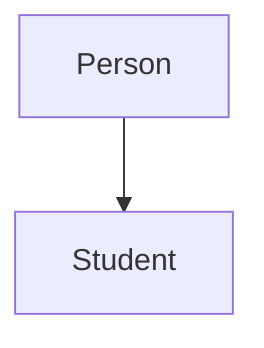
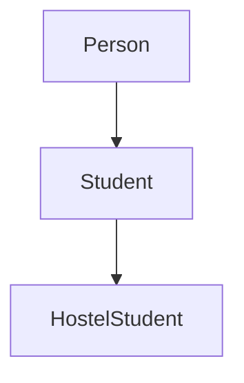
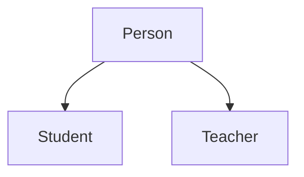
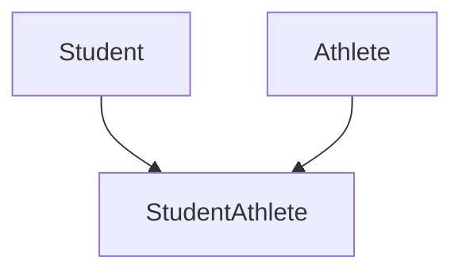
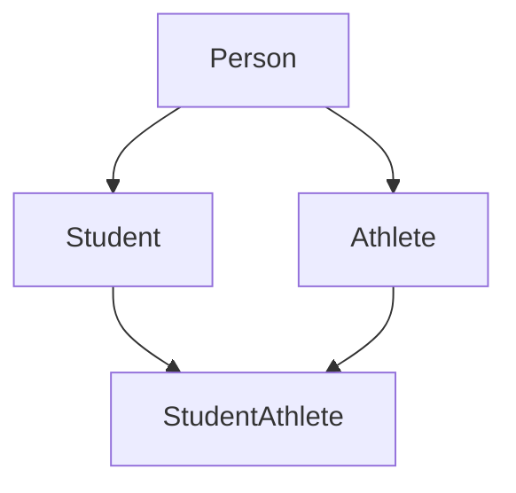

# Inheritance

A `Student` has a name and introduces themselves. A `Teacher` also has a name and introduces themselves in the same way. If both classes contain the same attributes and methods, the code is written twice, and every later change has to be made in both places.

Object-oriented programming avoids this repetition through **inheritance**, one of the four pillars of OOP. The common code is written once in a parent class, and child classes reuse it.

> **Inheritance is a mechanism in which a class, called the child class, reuses the attributes and methods of another class, called the parent class. It promotes code reusability.**

## Parent and Child Classes

The two classes in an inheritance relationship have specific names:

| Term | Also Called | Meaning |
| --- | --- | --- |
| **Parent class** | Base class, superclass | The class whose attributes and methods are reused |
| **Child class** | Derived class, subclass | The class that reuses them |

Inheritance represents an **"is-a" relationship**. A student **is a** person, and a teacher **is a** person. So `Student` and `Teacher` can both be child classes of a `Person` class.

Use inheritance when one class is a **specialised version** of another. For example, a `Student` is a `Person`. If two classes merely share some behaviour but do not have this relationship, inheritance may not be the best choice.

## Establishing an Inheritance Relationship

To make one class inherit from another, write the parent class name inside parentheses after the child class name.

**Syntax:**

```
class ChildClass(ParentClass):
    pass
```

**Example:**

```python
class Person:
    def introduce(self):
        print("Hello, I am a person")

class Student(Person):
    pass

student1 = Student()
student1.introduce()
```

**Output:**

```
Hello, I am a person
```

- `class Student(Person):` makes `Person` the **parent class** of `Student`.
- `Student` has no methods of its own. `pass` only keeps the class body from being empty.
- Even so, `student1.introduce()` works, because `Student` **inherits** `introduce()` from `Person`.

A child class also inherits the parent's **attributes**, including the `__init__()` method that creates them.

```python
class Person:
    def __init__(self, name):
        self.name = name

class Student(Person):
    pass

student1 = Student("Ravi")
print(student1.name)
```

**Output:**

```
Ravi
```

`Student` does not define its own `__init__()`. It inherits the `__init__()` of `Person`, so `Student("Ravi")` stores the name in `student1.name`.

## How Python Finds an Inherited Method

When `student1.introduce()` runs, Python first looks for `introduce()` in `Student`, the object's own class. If it isn't found, Python checks the parent class, `Person`. This search follows a defined order called the **method resolution order (MRO)**. If Python cannot find the method in any class in that order, it raises an **`AttributeError`**.

**Points to note:**

- A child class can also define **its own methods**, in addition to the methods it inherits.
- Inheritance works **only from parent to child**. A parent object cannot use a method that is defined only in a child class.
- In Python 3, ordinary classes ultimately inherit from the built-in class **`object`**, even when no parent class is written.

## Types of Inheritance

Inheritance is commonly explained using five types, and Python supports all of them. In each diagram, the parent class is at the top, and the arrow points to the class that inherits from it.

### Single Inheritance

> **Single inheritance is a type of inheritance in which one child class inherits from one parent class.**



```python
class Person:
    def speak(self):
        print("I am a person")

class Student(Person):
    def study(self):
        print("I am studying")

student1 = Student()
student1.speak()
student1.study()
```

**Output:**

```
I am a person
I am studying
```

`Student` has one parent, `Person`. A `Student` object uses `speak()` from `Person` and `study()` from its own class.

### Multilevel Inheritance

> **Multilevel inheritance is a type of inheritance in which a class inherits from another class that also inherits from a parent class, forming a chain.**



```python
class Person:
    def speak(self):
        print("I am a person")

class Student(Person):
    def study(self):
        print("I am studying")

class HostelStudent(Student):
    def stay(self):
        print("I stay in the hostel")

student1 = HostelStudent()
student1.speak()
student1.study()
student1.stay()
```

**Output:**

```
I am a person
I am studying
I stay in the hostel
```

`HostelStudent` inherits from `Student`, and `Student` inherits from `Person`. A `HostelStudent` object can therefore use the methods of all three classes in the chain.

### Hierarchical Inheritance

> **Hierarchical inheritance is a type of inheritance in which more than one child class inherits from the same parent class.**



```python
class Person:
    def speak(self):
        print("I am a person")

class Student(Person):
    def study(self):
        print("I am studying")

class Teacher(Person):
    def teach(self):
        print("I am teaching")

student1 = Student()
teacher1 = Teacher()

student1.speak()
student1.study()
teacher1.speak()
teacher1.teach()
```

**Output:**

```
I am a person
I am studying
I am a person
I am teaching
```

`Student` and `Teacher` share the same parent, so both can use `speak()`. Each child also has its own method, which the other child does not have.

### Multiple Inheritance

> **Multiple inheritance is a type of inheritance in which one child class inherits from more than one parent class.**



The parent classes are written inside the parentheses, separated by commas.

```python
class Student:
    def study(self):
        print("I am studying")

class Athlete:
    def play(self):
        print("I am playing")

class StudentAthlete(Student, Athlete):
    pass

player1 = StudentAthlete()
player1.study()
player1.play()
```

**Output:**

```
I am studying
I am playing
```

`StudentAthlete` has two parents. It uses `study()` from `Student` and `play()` from `Athlete`.

Multiple inheritance raises one important issue: when two parent classes have a method with the **same name**, the child class needs a rule to decide which one to use.

**Python solves this with the MRO.** Before searching for a method, Python arranges the classes into a fixed search order. For the examples in this topic, you can understand the MRO using these rules:

1. Python checks the child class first.
2. It then checks the parent classes according to the order in which they are listed, while respecting the inheritance relationships between them.
3. A shared parent is checked only once, after the classes that inherit from it.
4. The built-in `object` class comes last in these examples.

Python then runs the **first** matching method it finds in this order. The `mro()` method shows the order for any class.

```python
class Student:
    def describe(self):
        print("I am a student")

class Athlete:
    def describe(self):
        print("I am an athlete")

class StudentAthlete(Student, Athlete):
    pass

player1 = StudentAthlete()
player1.describe()

for cls in StudentAthlete.mro():
    print(cls.__name__)
```

**Output:**

```
I am a student
StudentAthlete
Student
Athlete
object
```

- Both parents define `describe()`, but `StudentAthlete` does not.
- `StudentAthlete.mro()` returns the classes in search order, and `__name__` gives each class's name.
- Python searches `StudentAthlete`, then `Student`. It finds `describe()` in `Student` and runs it, so `Athlete` is never reached.
- Writing `class StudentAthlete(Athlete, Student):` would change the order, and Python would run the version in `Athlete`.

**Java** takes a different approach. A Java class cannot inherit from multiple classes. Instead, it can implement several **interfaces**. An interface defines a contract, a set of rules that a class agrees to follow. It can declare methods that the class must implement, and it can also provide default method implementations, which are methods that already contain code.

| | Python | Java |
| --- | --- | --- |
| Inheriting from multiple classes | Allowed | Not allowed |
| Handling conflicting inherited methods | The MRO determines which implementation is found first | Conflicting interface default methods may require an explicit override, where the class writes its own version |

### Hybrid Inheritance

> **Hybrid inheritance is a type of inheritance that combines two or more types of inheritance.**



```python
class Person:
    def speak(self):
        print("I am a person")

class Student(Person):
    def study(self):
        print("I am studying")

class Athlete(Person):
    def play(self):
        print("I am playing")

class StudentAthlete(Student, Athlete):
    pass

player1 = StudentAthlete()
player1.speak()
player1.study()
player1.play()
```

**Output:**

```
I am a person
I am studying
I am playing
```

This example combines two types:

- `Student` and `Athlete` both inherit from `Person`, which is **hierarchical** inheritance.
- `StudentAthlete` inherits from both `Student` and `Athlete`, which is **multiple** inheritance.

These relationships form a **diamond shape**. A `StudentAthlete` object can use methods from all four classes. Here, the MRO is `StudentAthlete`, `Student`, `Athlete`, `Person` and `object`. The shared parent, `Person`, comes **after** both `Student` and `Athlete`, following rule 3 of the MRO rules above.

## Points to Remember

- **Inheritance promotes code reuse** by allowing child classes to use attributes and methods from parent classes.
- **Python searches for methods using the MRO**, starting with the object's own class.
- **A child class can add its own methods**, but inheritance works only from parent to child.
- **The five types of inheritance** are single, multilevel, hierarchical, multiple and hybrid.

## Check Your Understanding

1. If `Car` inherits from `Vehicle`, which class is the parent class?
2. If `HostelStudent` inherits from `Student`, and `Student` inherits from `Person`, which classes' methods can `HostelStudent` reuse?
3. If both parent classes of `StudentAthlete` define `describe()`, how does Python decide which version runs?
4. Why might inheritance be unsuitable for two classes that merely share a method?

### Answers

1. `Vehicle` is the parent class, and `Car` is the child class.
2. `HostelStudent` can reuse the methods of `Student` and `Person`, as well as its own.
3. Python follows the MRO and runs the first `describe()` it finds. In `class StudentAthlete(Student, Athlete):`, that is the version in `Student`.
4. Inheritance represents an "is-a" relationship. If one class is not a specialised version of the other, inheritance can make the design confusing.

## Further Reading

- 📎 **Inheritance in Python** — https://www.tutorialspoint.com/python/python_inheritance.htm
- 📎 **Official Python guide to inheritance** — https://docs.python.org/3/tutorial/classes.html#inheritance

A child class can use an inherited method as it is. Sometimes, however, the child needs that method to behave differently. In the next topic, **Method Overriding and `super()`**, you'll learn how a child class can provide its own version of an inherited method and still reuse the parent's code when needed.
