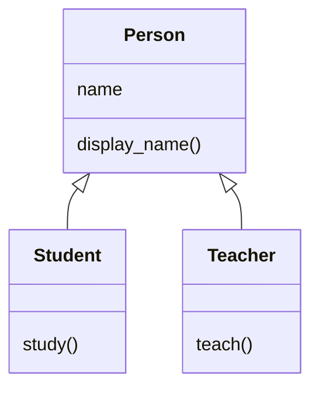
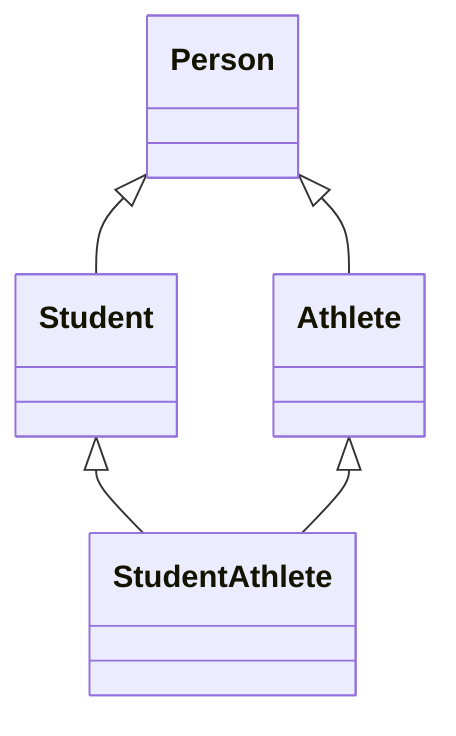

# Inheritance

A college has both students and teachers. Every student and every teacher has a name, and both need a way to display it. Writing the same name-related code separately in a `Student` class and a `Teacher` class would repeat it. **Inheritance** lets both classes share that code from one common class.

## Inheritance

> **Inheritance allows a class to reuse the methods and attributes of another class, while also defining its own behaviour.**

The two classes involved have specific names:

| Term | Also Called | Meaning |
| --- | --- | --- |
| **Parent class** | Base class, superclass | The class whose methods and attributes are reused. |
| **Child class** | Derived class, subclass | The class that reuses them. |

Inheritance represents an **"is-a" relationship**. A student **is a** person, and a teacher **is a** person, so `Student` and `Teacher` can both be child classes of a `Person` parent class.

## Creating a Child Class

A child class is created by writing the parent class name inside parentheses after the child class name.

**Syntax:**

```python
class ParentClass:
    pass

class ChildClass(ParentClass):
    pass
```

**Example:**

```python
class Person:
    def __init__(self, name):
        self.name = name

    def display_name(self):
        print("Name:", self.name)

class Student(Person):
    pass

class Teacher(Person):
    pass

student1 = Student("Ravi")
teacher1 = Teacher("Meena")

student1.display_name()
teacher1.display_name()
```

**Output:**

```
Name: Ravi
Name: Meena
```

`Student` and `Teacher` contain no code of their own, yet both work. When Python looks up a method on an object, it **first checks the object's class. If the method isn't defined there, it searches the parent class.**

- `Student` has no `__init__` method, so `Student("Ravi")` runs the `__init__` method of `Person`, which creates the `name` attribute.
- `Student` has no `display_name()` method either, so `student1.display_name()` runs the one defined in `Person`.

## Adding Methods to a Child Class

A child class can also define its own methods, in addition to the ones it inherits.

```python
class Person:
    def __init__(self, name):
        self.name = name

    def display_name(self):
        print("Name:", self.name)

class Student(Person):
    def study(self):
        print(self.name, "is studying")

class Teacher(Person):
    def teach(self):
        print(self.name, "is teaching")

student1 = Student("Ravi")
teacher1 = Teacher("Meena")

student1.display_name()
student1.study()
teacher1.teach()
```

**Output:**

```
Name: Ravi
Ravi is studying
Meena is teaching
```

`study()` uses `self.name`, which is set by the inherited `__init__` method. The diagram shows what each class defines. The arrows point from each child class to its parent class.



**Inheritance passes behaviour from parent to child, not from child to parent.** A `Person` object cannot use `study()`, because that method is defined only in `Student`. Calling it raises an **`AttributeError`**.

## Method Overriding

Sometimes a child class needs an inherited method to behave differently, such as displaying `Student: Ravi` instead of `Name: Ravi`.

> **Method overriding means writing a method in a child class with the same name as a method in its parent class. Objects of the child class then use the child's version.**

```python
class Person:
    def __init__(self, name):
        self.name = name

    def display_name(self):
        print("Name:", self.name)

class Student(Person):
    def display_name(self):
        print("Student:", self.name)

class Teacher(Person):
    def display_name(self):
        print("Teacher:", self.name)

person1 = Person("Arun")
student1 = Student("Ravi")
teacher1 = Teacher("Meena")

person1.display_name()
student1.display_name()
teacher1.display_name()
```

**Output:**

```
Name: Arun
Student: Ravi
Teacher: Meena
```

When `student1.display_name()` runs, Python finds `display_name()` in `Student` first, so it runs the `Student` version. **Overriding does not change the parent's method.** `person1` still displays `Name: Arun`.

**The method name must match exactly.** A method named `display_Name` in `Student` would be a new method, and `display_name()` would still run the `Person` version without any error.

### Overriding the `__init__` Method

A child object often needs more data than a parent object. A `Student` needs a name and a roll number, so `Student` overrides `__init__`.

```python
class Person:
    def __init__(self, name):
        self.name = name

    def display_name(self):
        print("Name:", self.name)

class Student(Person):
    def __init__(self, name, roll_number):
        self.name = name
        self.roll_number = roll_number

student1 = Student("Ravi", 101)

student1.display_name()
print(student1.roll_number)
```

**Output:**

```
Name: Ravi
101
```

**Once the child defines its own `__init__`, the parent's `__init__` does not run automatically.** The child must create every attribute the object needs, so `Student` sets `self.name` again, even though `Person` already does this.

## The `super()` Function

> **`super()` allows a child class to call methods from its parent class, making it easier to reuse the parent's code without repeating it.**

The most common use of `super()` is inside the child's `__init__()`. The child calls the parent's `__init__()` to set up the parent's attributes, and then adds its own.

```python
class Person:
    def __init__(self, name):
        self.name = name

    def display_name(self):
        print("Name:", self.name)

class Student(Person):
    def __init__(self, name, roll_number):
        super().__init__(name)
        self.roll_number = roll_number

student1 = Student("Ravi", 101)

student1.display_name()
print(student1.roll_number)
```

**Output:**

```
Name: Ravi
101
```

Here is what happens when `Student("Ravi", 101)` runs:

1. Python runs the `__init__()` method of `Student`.
2. `super().__init__(name)` calls the `__init__()` method of `Person`, which stores `"Ravi"` in `self.name`.
3. `Student` then stores `101` in `self.roll_number`.

**Do not write `self` inside `super().__init__()`.** Python adds it automatically. The parentheses after `super` are required.

### Extending a Method

`super()` works with **any method** of the parent class. A child can **extend** a parent's method by running the parent's version first and then adding its own work.

```python
class Person:
    def __init__(self, name):
        self.name = name

    def display_details(self):
        print("Name:", self.name)

class Student(Person):
    def __init__(self, name, roll_number):
        super().__init__(name)
        self.roll_number = roll_number

    def display_details(self):
        super().display_details()
        print("Roll Number:", self.roll_number)

student1 = Student("Ravi", 101)
student1.display_details()
```

**Output:**

```
Name: Ravi
Roll Number: 101
```

| Approach | What the Child Does | Result |
| --- | --- | --- |
| **Replacing** | Overrides the method without calling `super()` | Only the child's version runs. |
| **Extending** | Overrides the method and calls `super()` inside it | The parent's version runs, then the child's extra work. |

## Types of Inheritance

Classes can be connected in different ways. Python supports five common patterns.

| Type | How the Classes Are Connected | Example |
| --- | --- | --- |
| **Single** | One child class inherits from one parent class. | `Person` → `Student` |
| **Multilevel** | A class inherits from a child class, forming a chain. | `Person` → `Student` → `HostelStudent` |
| **Hierarchical** | Many child classes inherit from one parent class. | `Person` → `Student` and `Teacher` |
| **Multiple** | One child class inherits from more than one parent class. | `Student` and `Athlete` → `StudentAthlete` |
| **Hybrid** | A combination of two or more of the above types. | `Person` → `Student` and `Athlete` → `StudentAthlete` |

### Multiple Inheritance

For multiple inheritance, the parent classes are written inside the parentheses, separated by commas.

```python
class Student:
    def study(self):
        print("I am studying")

class Athlete:
    def play(self):
        print("I am playing")

class StudentAthlete(Student, Athlete):
    pass

player1 = StudentAthlete()
player1.study()
player1.play()
```

**Output:**

```
I am studying
I am playing
```

`StudentAthlete` has no code of its own, but it gets `study()` from `Student` and `play()` from `Athlete`. Unlike Java, **Python allows a class to inherit from more than one class.**

## Method Resolution Order

When several parent classes define the same method, Python needs a rule to decide which version to run.

> **The method resolution order (MRO) is the order in which Python searches classes to find a method.**

In this hybrid example, `Student` and `Athlete` both inherit from `Person`, and `StudentAthlete` inherits from both. The classes form a **diamond shape**.



```python
class Person:
    def speak(self):
        print("I am a person")

class Student(Person):
    def speak(self):
        print("I am a student")

class Athlete(Person):
    def speak(self):
        print("I am an athlete")

class StudentAthlete(Student, Athlete):
    pass

player1 = StudentAthlete()
player1.speak()
print(StudentAthlete.mro())
```

**Output:**

```
I am a student
[<class '__main__.StudentAthlete'>, <class '__main__.Student'>, <class '__main__.Athlete'>, <class '__main__.Person'>, <class 'object'>]
```

The `mro()` method displays the search order: `StudentAthlete`, `Student`, `Athlete`, `Person`, `object`. You can ignore the `__main__` part for now. `StudentAthlete` has no `speak()`, so Python moves to `Student`, finds `speak()` there and stops searching.

**The order of the parent classes matters.** With `class StudentAthlete(Athlete, Student):`, Python would search `Athlete` first, and the output would be `I am an athlete`.

`super()` also follows the MRO. It calls the next class in the MRO, which is not always the direct parent class.

## Further Reading

- 📎 **Official Python guide to inheritance** — https://docs.python.org/3/tutorial/classes.html#inheritance
- 📎 **Official Python reference for `super()`** — https://docs.python.org/3/library/functions.html#super
- 📎 **Official Python guide to multiple inheritance** — https://docs.python.org/3/tutorial/classes.html#multiple-inheritance

Child classes can now override the methods they inherit, so the same method call can behave differently for different objects. In the next topic, **Polymorphism**, the third pillar, you'll learn how Python uses this to let one piece of code work with objects of many different classes.
