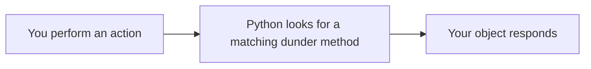

# Dunder Methods

Objects of built-in types work naturally with Python's built-in functions and operators. A string can be printed, a list can be measured with `len()`, and two numbers can be added with `+`. Objects of your own classes do not automatically support every operation in the way you might expect. You can define **dunder methods** to tell Python how these objects should behave with particular functions and operators.

> **Dunder methods are special methods whose names start and end with two underscores. Python calls them automatically when an object is used with supported built-in functions, operators, or other language features. They allow objects of your own classes to work with Python's built-in features.**

The word **dunder** is short for "**d**ouble **under**score". Dunder methods are also called **magic methods** or **special methods**. `__init__()` is one dunder method: Python calls it automatically to initialise an object when the object is created.

## How Dunder Methods Work

Many commonly used dunder methods follow this pattern:



For example:

- `print(student1)` → Python looks for `__str__()`.
- `len(room)` → Python looks for `__len__()`.
- `trip1 + trip2` → Python looks for `__add__()`.
- `trip1 == trip2` → Python looks for `__eq__()`.

**The action gives you a clue to the dunder method.** You do not need to memorise every method at once. The sections below introduce each method at the moment it solves a problem.

## Displaying an Object with `__str__()`

Printing an object of your own class gives a surprising result.

```python
class Student:
    def __init__(self, name, marks):
        self.name = name
        self.marks = marks

student1 = Student("Ravi", 85)
print(student1)
```

**Possible output:**

```
<__main__.Student object at 0x7f40a11feed0>
```

Python shows only the class name and an identifier starting with `0x`. The exact output will be different on your computer. Python cannot display the name and marks, because the class has not told Python how to describe a student.

The action here is `print()`, so Python looks for `__str__()`.

> **`__str__()` returns a readable string that describes the object. Python calls it when the object is passed to `print()` or `str()`.**

```python
class Student:
    def __init__(self, name, marks):
        self.name = name
        self.marks = marks

    def __str__(self):
        return "Student: " + self.name + ", Marks: " + str(self.marks)

student1 = Student("Ravi", 85)
print(student1)
```

**Output:**

```
Student: Ravi, Marks: 85
```

You still write `print(student1)`. **Python calls `__str__()` behind the scenes** and displays the string it returns. `__str__()` must return a string.

## Representing an Object with `__repr__()`

Printing a list of students uses `__repr__()` for each object inside the list, rather than `__str__()`. Python also calls `__repr__()` when you use `repr()` directly.

> **`__repr__()` returns a string that represents an object clearly for programmers. Ideally, the string should help them understand the object and, when practical, recreate it.**

The string returned by `__repr__()` should clearly represent the object. When practical, it can look like the code used to create the object.

```python
class Student:
    def __init__(self, name, marks):
        self.name = name
        self.marks = marks

    def __str__(self):
        return "Student: " + self.name

    def __repr__(self):
        return "Student('" + self.name + "', " + str(self.marks) + ")"

student1 = Student("Ravi", 85)
student2 = Student("Priya", 92)

print(student1)
print([student1, student2])
```

**Output:**

```
Student: Ravi
[Student('Ravi', 85), Student('Priya', 92)]
```

- `print(student1)` uses `__str__()`, which is meant for **users**.
- `print([student1, student2])` uses `__repr__()` for each object inside the list. This form is meant for **programmers**.

If a class defines only `__repr__()`, Python also uses it for `print()`.

## Measuring an Object with `__len__()`

Passing an object of your own class to `len()` raises a **`TypeError`** if the class does not define a length.

The action here is `len()`, so Python looks for `__len__()`.

> **`__len__()` returns the length of an object. Python calls it when the object is passed to `len()`.**

```python
class Classroom:
    def __init__(self, students):
        self.students = students

    def __len__(self):
        return len(self.students)

room = Classroom(["Ravi", "Priya", "Arun"])
print(len(room))
```

**Output:**

```
3
```

`len(room)` calls `__len__()`, which returns the number of students in the classroom. `__len__()` must return a non-negative integer (0 or more).

## Operator Overloading

The same pattern works for many operators. Python provides corresponding dunder methods that let your class define how those operators behave with its objects.

> **Operator overloading means giving an operator, such as `+`, a meaning for objects of your own class.**

### Overloading the `+` Operator

Python needs a suitable method to define how `+` works with objects of your own class. If neither operand supports the operation, Python raises a **`TypeError`**. An **operand** is a value on either side of an operator, such as `trip1` and `trip2` in `trip1 + trip2`.

The action here is `+`, so Python looks for `__add__()`.

```python
class Distance:
    def __init__(self, km):
        self.km = km

    def __add__(self, other):
        return Distance(self.km + other.km)

    def __str__(self):
        return str(self.km) + " km"

trip1 = Distance(120)
trip2 = Distance(80)
total = trip1 + trip2

print(total)
```

**Output:**

```
200 km
```

When Python runs `trip1 + trip2`, it calls `trip1.__add__(trip2)`:

- `self` is `trip1`, the object on the left of `+`.
- `other` is `trip2`, the object on the right of `+`.
- The method returns a new `Distance` object with the total distance.

`__add__()` returns a **new** object; it does not change `trip1` or `trip2`. Printing `total` then uses `__str__()`, so the result appears as `200 km`.

### Overloading Comparison Operators

By default, two separate objects of an ordinary user-defined class are **not equal** with `==`, even if they contain the same values. Defining `__eq__()` lets you compare objects by their values instead.

The actions here are `==` and `<`, so Python looks for `__eq__()` and `__lt__()`.

```python
class Distance:
    def __init__(self, km):
        self.km = km

    def __eq__(self, other):
        return self.km == other.km

    def __lt__(self, other):
        return self.km < other.km

trip1 = Distance(120)
trip2 = Distance(80)
trip3 = Distance(120)

print(trip1 == trip3)
print(trip1 == trip2)
print(trip2 < trip1)
```

**Output:**

```
True
False
True
```

`trip1` and `trip3` are separate objects, but `__eq__()` compares their `km` values, so `trip1 == trip3` is `True`.

### Operator Overloading and Method Overloading

Python **supports operator overloading**, but not traditional method overloading, as explained in **Polymorphism**. Operator overloading gives an existing operator a new meaning for your class. It does not create several methods with the same name.

## Quick Reference

The last few rows follow the same pattern and are included for reference.

| What You Write | What Python Looks For | Memory Clue |
| --- | --- | --- |
| `print(obj)` | `__str__()` | Show it |
| `repr(obj)` | `__repr__()` | Represent it |
| `len(obj)` | `__len__()` | Measure it |
| `a + b` | `__add__()` | Add it |
| `a - b` | `__sub__()` | Subtract it |
| `a * b` | `__mul__()` | Multiply it |
| `a == b` | `__eq__()` | Check equality |
| `a < b` | `__lt__()` | Compare it (less than) |
| `a > b` | `__gt__()` | Compare it (greater than) |

## Points to Remember

- **Python calls dunder methods automatically.** You write `print(student1)` or `trip1 + trip2`, not `student1.__str__()` or `trip1.__add__(trip2)`.
- **Use the special method names defined by Python**, such as `__str__()` and `__len__()`. Avoid inventing your own double-underscore names, because Python reserves this naming pattern for special purposes.
- **Return the correct type.** For example, `__str__()` and `__repr__()` must return strings, and `__len__()` must return a non-negative integer.

## Further Reading

- 📎 **Official Python reference for special method names** — https://docs.python.org/3/reference/datamodel.html#special-method-names

You've already seen decorators such as `@classmethod` and `@abstractmethod`. In the next topic, **Decorators**, you'll learn how they work and how to create your own.