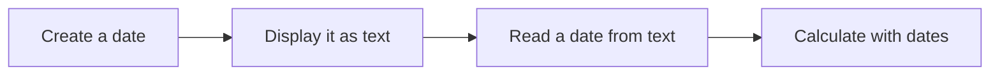

# Dates and Times

Dates show up in almost every app you use. A college portal shows today's date, an exam schedule lists dates neatly, a form asks you to type your date of birth, and a fee reminder counts the days left to pay. Behind all of this are four simple tasks: **create**, **display**, **read** and **calculate**. Python's **`datetime`** module handles each one.

The flow below shows these tasks, and the table matches each one to its tool:



| Step | What You Do | Tool |
| --- | --- | --- |
| **Create** | Get today's date or make a specific date | `date.today()`, `date()` |
| **Display** | Show a date in a chosen format | `strftime()` |
| **Read** | Turn text into a `datetime` object | `strptime()` |
| **Calculate** | Add days or find the gap between dates | `timedelta` |

This topic covers these four tasks in order, one step at a time.

> **The `datetime` module is a standard library module for creating, displaying, reading and calculating dates and times.**

It provides three main types used in this topic:

| Type | What It Stores | Example |
| --- | --- | --- |
| `date` | A date: year, month and day | `2026-03-15` |
| `datetime` | A date and a time together | `2026-03-15 09:30:00` |
| `timedelta` | A length of time, such as a number of days | `10 days` |

## Step 1: Creating Dates

### Getting the Current Date and Time

`date.today()` returns today's date, and `datetime.now()` returns the current date and time.

```python
from datetime import date, datetime

print(date.today())
print(datetime.now())
```

**Possible output:**

```
2026-10-21
2026-10-21 11:56:45.789353
```

The output **depends on when you run the program**. Dates are shown in the order year, month and day. The time includes hours, minutes and seconds. It may also include fractions of a second.

### Creating a Specific Date

A specific date is created by passing the year, month and day to `date()`.

```python
from datetime import date

exam = date(2026, 3, 15)

print(exam)
print(exam.year)
print(exam.month)
print(exam.day)
```

**Output:**

```
2026-03-15
2026
3
15
```

`exam.year`, `exam.month` and `exam.day` give each part of the date separately.

## Step 2: Displaying Dates

The `strftime()` method changes a date or time into a string, in the format you choose. Each part of the format is written using a **format code**.

| Format Code | Meaning | Example |
| --- | --- | --- |
| `%d` | Day, with two digits | `15` |
| `%m` | Month, as a number with two digits | `03` |
| `%Y` | Year, with four digits | `2026` |
| `%B` | Full month name | `March` |
| `%A` | Full day name | `Sunday` |
| `%I` | Hour, in 12-hour format | `09` |
| `%M` | Minute | `30` |
| `%p` | AM or PM | `AM` |

```python
from datetime import datetime

moment = datetime(2026, 3, 15, 9, 30)

print(moment.strftime("%d-%m-%Y"))
print(moment.strftime("%d %B %Y"))
print(moment.strftime("%A, %I:%M %p"))
```

**Output:**

```
15-03-2026
15 March 2026
Sunday, 09:30 AM
```

- `datetime(2026, 3, 15, 9, 30)` creates 15 March 2026 at 9:30 in the morning.
- Each `strftime()` call shows the same moment in a different format.
- Characters that are not format codes, such as `-`, `,` and spaces, appear exactly as written.

Month and day names appear in English on most computers, but they can follow the language setting of your computer.

## Step 3: Reading Dates from Text

The `strptime()` method does the opposite of `strftime()`. It reads a date written as text and converts it into a `datetime` object. The format codes should match the order and separators used in the text.

```python
from datetime import datetime

text = "15-03-2026"

exam = datetime.strptime(text, "%d-%m-%Y")
print(exam)
print(exam.year)
```

**Output:**

```
2026-03-15 00:00:00
2026
```

- `"%d-%m-%Y"` tells Python that the text has the day, then the month, then the year, separated by `-`.
- The text has no time, so the time is set to `00:00:00`.

**A simple way to remember the difference:** `strftime()` **f**ormats a date or time into text, while `strptime()` **p**arses text into a `datetime` object. Parsing means reading text and turning it into structured data.

## Step 4: Calculating with Dates

A **`timedelta`** represents a length of time. It can be added to a date, and subtracting two dates gives a `timedelta`.

```python
from datetime import date, timedelta

exam = date(2026, 3, 15)

result_day = exam + timedelta(days=10)
print(result_day)

start = date(2026, 1, 1)
gap = exam - start
print(gap.days)
```

**Output:**

```
2026-03-25
73
```

- `exam + timedelta(days=10)` gives the date 10 days after the exam.
- `exam - start` gives the time between the two dates, and `gap.days` returns it as a number of days.

## Points to Remember

- **Import what you need** from the `datetime` module, such as `from datetime import date`.
- **`strftime()`** formats a date or time into text, while **`strptime()`** converts text into a `datetime` object.
- **`timedelta`** is used to add time to a date or find the difference between dates.

## Further Reading

- 📎 **Official Python reference for the `datetime` module** — https://docs.python.org/3/library/datetime.html
- 📎 **Official list of format codes** — https://docs.python.org/3/library/datetime.html#strftime-and-strptime-format-codes

As a program grows, it may need many modules of its own. In the next topic, **Packages**, you'll learn how to group related modules together in folders.
