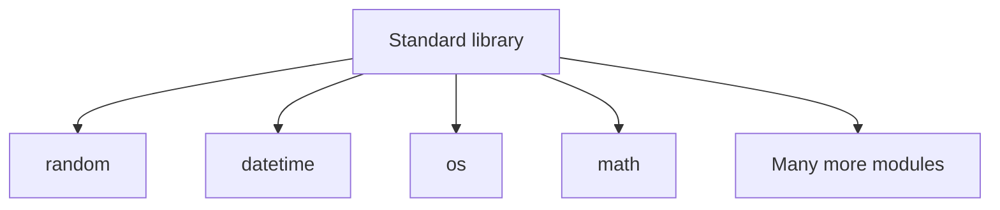

# Built-in and External Libraries

Many programming tasks are common, such as generating random numbers, calculating averages, working with dates or fetching data from a website. Writing code for each of these from scratch takes time, and the code may contain mistakes. Instead, programmers reuse code that has already been written and tested. This ready-made code is shared as **libraries**.

> **A library is a collection of reusable code, made up of modules and packages, that provides features for common tasks. It saves time, because programmers can reuse tested code instead of writing it from scratch.**

A library is larger than a module or a package:

| Term | What It Is | Example |
| --- | --- | --- |
| **Module** | A Python file containing code that can be imported | `random`, `math`, `os` |
| **Package** | A way to organise related modules under a package name | `json`, `email`, `urllib` |
| **Library** | Reusable code that provides features for programmers | Python's standard library, `pandas` |

For this lesson, we'll group reusable Python libraries into two categories: the standard library and external libraries.

| | Standard Library | External Libraries |
| --- | --- | --- |
| Comes with a standard Python installation | Yes, generally | No |
| Needs separate installation | Usually no | Usually yes |
| Examples | `random`, `datetime`, `os` | `requests`, `pandas`, `numpy` |

## The Python Standard Library

> **The Python standard library is the large collection of modules and packages that is installed automatically along with Python. Its modules are generally available without separate installation, although availability can depend on the Python version and operating system.**

The standard library is **one library**. Modules such as `random`, `datetime` and `os` are **not separate libraries**. They are modules **inside** the standard library.



Because so many tools are ready to use as soon as Python is installed, Python is often described as having **"batteries included"**.

### Standard Library Modules You Have Already Used

Several modules in this course are part of the standard library:

| Module | Used For | Topic |
| --- | --- | --- |
| `abc` | Creating abstract classes | **Abstraction** |
| `os` | Working with folders and paths | **File Paths and Errors** |
| `csv` | Reading and writing CSV files | **CSV Files** |
| `json` | Reading and writing JSON data | **JSON Files** |
| `math` | Mathematical functions | **Modules and Imports** |
| `re` | Searching for patterns in text | **Regular Expressions** |
| `datetime` | Working with dates and times | **Dates and Times** |

The sections below introduce three more useful modules from the standard library.

### The `random` Module

The **`random`** module provides functions for generating **pseudo-random** values and selecting random items. Pseudo-random values look random, but Python produces them using a calculation.

```python
import random

print(random.randint(1, 6))
print(random.choice(["Ravi", "Priya", "Arun"]))
```

**Possible output:**

```
6
Ravi
```

- `random.randint(1, 6)` returns a random whole number from 1 to 6, including both 1 and 6, like rolling a dice.
- `random.choice()` picks one random item from a list.

**The output can change each time the program runs.** The same values may appear again by chance.

### The `statistics` Module

The **`statistics`** module calculates common statistics, such as the average of a set of numbers.

```python
import statistics

marks = [85, 92, 78, 90, 70]

print(statistics.mean(marks))
print(statistics.median(marks))
```

**Output:**

```
83
85
```

- `statistics.mean()` returns the **average**: the total of all the marks divided by the number of marks.
- `statistics.median()` returns the **middle value** when the numbers are arranged in order. Here, the ordered marks are `70, 78, 85, 90, 92`, so the median is `85`. If there is an even number of values, it returns the average of the two middle values.

### The `collections` Module

The **`collections`** module provides extra data structures. One of the most useful is **`Counter`**, which counts how many times each item appears.

```python
from collections import Counter

subjects = ["Maths", "Physics", "Maths", "Chemistry", "Maths", "Physics"]

count = Counter(subjects)
print(count)
print(count["Maths"])
```

**Output:**

```
Counter({'Maths': 3, 'Physics': 2, 'Chemistry': 1})
3
```

- `Counter(subjects)` counts each subject in the list.
- `count["Maths"]` gives the number of times `"Maths"` appears.

The standard library contains many more modules. The official documentation lists every module and explains how to use it.

## External Libraries

The standard library covers many common tasks, but not all of them. For tasks such as analysing large tables of data, drawing charts or building websites, programmers use **external libraries**.

> **An external library is reusable code distributed separately from Python's standard library. It usually needs to be installed in your Python environment before it can be imported.**

Most external libraries are shared on the **Python Package Index (PyPI)** and installed using **`pip`**. How to install them safely is covered in the next topic, **Virtual Environments and pip**.

### Popular External Libraries

| Library | Used For |
| --- | --- |
| `requests` | Sending requests to websites and getting data from APIs |
| `numpy` | Fast calculations with large sets of numbers |
| `pandas` | Working with data in tables, such as spreadsheets and CSV files |
| `matplotlib` | Drawing charts and graphs |
| `flask` | Building simple web applications |
| `django` | Building large, full-featured web applications |
| `scikit-learn` | Machine learning, such as making predictions from data |

You'll use two of these libraries later this week: `requests` in **Calling an API with requests** and `pandas` in **Introduction to pandas**.

## Choosing Between the Standard Library and External Libraries

1. **Check the standard library first.** If a standard library module can do the task, no separate installation is usually needed.
2. **Use an external library** when the task needs features the standard library does not provide, or when a popular library makes the task much simpler.

## Points to Remember

- **A library** is reusable code that provides useful features and may contain modules and packages.
- **The standard library** comes with Python and generally requires no separate installation.
- **External libraries** are distributed separately from Python's standard library and usually need to be installed in the appropriate Python environment.
- **Check the standard library first** before installing an external library.

## Further Reading

- 📎 **Official Python Standard Library reference** — https://docs.python.org/3/library/index.html
- 📎 **Official Python tutorial: a brief tour of the standard library** — https://docs.python.org/3/tutorial/stdlib.html
- 📎 **Python Package Index (PyPI)** — https://pypi.org

External libraries must be installed before they can be used, and different projects may need different versions of them. In the next topic, **Virtual Environments and pip**, you'll learn how to install and manage external libraries safely for each project.
