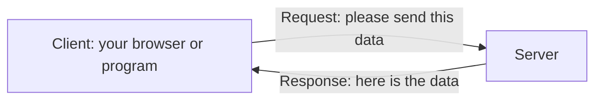

# Web APIs and API Keys

Many apps show information that they do not create themselves. A weather app shows today's temperature, a train app shows live running status, and a shopping app shows whether a payment went through. None of these apps stores all that information. Instead, they **ask another program on the internet for it** and receive a reply in a few seconds.

To write programs that work like this, you first need to understand how programs talk to each other over the internet. This topic explains it step by step, from the basics.

## How Programs Talk Over the Internet

Every time two programs communicate over the internet, one program **asks** and the other program **answers**.

> **A client is the program that sends a request for data or a service.**

> **A server is the program that receives the request, does the work and sends back a reply.**

You already use this every day. When you open a website:

1. Your **web browser** is the **client**. It asks for the page.
2. A **web server** receives the request and finds or generates the page.
3. The server sends the page back, and the browser displays it.



The message the client sends is called a **request**, and the reply from the server is called a **response**. A Python program can act as a client too, exactly like a browser.

## HTTP: The Rules for Requests and Responses

For a client and a server to understand each other, both must follow the same rules for writing requests and responses.

> **HTTP (HyperText Transfer Protocol) is the set of rules that clients and servers follow to send requests and responses over the web.**

A **protocol** is simply an agreed set of rules for communication.

You may also see **HTTPS**. The **S** stands for **secure**. HTTPS uses HTTP over an **encrypted** connection. **Encryption** converts data into a coded form that only the client and server can turn back into readable data. This helps prevent others from reading the data while it travels, helps protect it from being changed on the way, and verifies the server's identity. Most websites and APIs today use HTTPS.

## Understanding a URL

Every request is sent to a **URL**. You type URLs into your browser every day, but each URL is made of separate parts, and each part has a job.

> **A URL (Uniform Resource Locator) is the full address of something on the web, such as a page or a piece of data.**

Here is a URL used later in this topic:

```
https://jsonplaceholder.typicode.com/todos?userId=1
```

| Part | In This URL | What It Does |
| --- | --- | --- |
| **Scheme** | `https://` | The set of rules to use. Here, HTTPS |
| **Domain** | `jsonplaceholder.typicode.com` | The name of the server to contact |
| **Path** | `/todos` | Which data on that server you want |
| **Query string** | `?userId=1` | Extra details that filter or adjust the data |

### Query Parameters

The **query string** starts with a question mark, `?`. It contains one or more **query parameters**, each written as `name=value`.

| Symbol | Meaning | Example |
| --- | --- | --- |
| `?` | Starts the query string | `/todos?userId=1` |
| `=` | Joins a parameter's name to its value | `userId=1` |
| `&` | Separates one parameter from the next | `?userId=1&completed=true` |

These parameters request tasks belonging to user 1 that are completed, provided the API supports both filters. JSONPlaceholder supports both. **Query parameters only have the effect defined by the API**, so check its documentation for the parameters it accepts.

You may also see the word **URI** in documentation. A URI is a general name for an identifier of a resource, and every URL is a kind of URI. For this course, you can treat the two words as meaning the same thing.

## What a Request Contains

A request is more than just a URL. A typical HTTP request can include these parts:

| Part | What It Is | Example |
| --- | --- | --- |
| **Method** | The kind of action you want | `GET`, which means "send me data" |
| **URL** | The address of the data | `https://jsonplaceholder.typicode.com/todos/1` |
| **Headers** | Extra information about the request | The format of data the client accepts |
| **Body** | Data sent to the server, if any | The details of a new task to save |

> **A header is a piece of extra information sent with a request or a response, written as a name and a value.**

A simple request to read data usually has only a method, a URL and a few headers. A body is needed only when you **send** data to the server, such as when creating something new.

## HTTP Methods

The **method** tells the server what kind of action you want. Each method has a clear purpose:

| Method | Action | Everyday Example |
| --- | --- | --- |
| **GET** | Read data | View the details of a task |
| **POST** | Create new data | Add a new task |
| **PUT** | Replace existing data completely | Replace a task with new details |
| **PATCH** | Change part of existing data | Mark one task as completed |
| **DELETE** | Remove data | Delete a task |

These are the usual purposes of the methods. The exact actions supported by each endpoint depend on the API.

**GET is the most common method.** Every time you open a web page in a browser, the browser sends a GET request. The other methods are usually sent by programs, not by typing a URL into a browser.

## What a Response Contains

The server answers every request with a **response**, which has three parts:

| Part | What It Is | Example |
| --- | --- | --- |
| **Status code** | A three-digit number showing whether the request worked | `200` |
| **Headers** | Extra information about the response | The format of the data, such as JSON |
| **Body** | The data you asked for | The details of the task |

## HTTP Status Codes

The **status code** is the first thing to check in any response, because it tells you whether you received what you asked for.

| Code | Name | What It Means |
| --- | --- | --- |
| **200** | OK | The request worked, and the data is in the body |
| **201** | Created | New data was created, usually after a POST request |
| **400** | Bad Request | The request was written incorrectly, such as a wrong parameter |
| **401** | Unauthorized | The request needs a valid API key or login, and none was given |
| **403** | Forbidden | The server understood the request but refuses to allow it |
| **404** | Not Found | The requested data does not exist at that URL |
| **429** | Too Many Requests | Too many requests were sent in a short time |
| **500** | Internal Server Error | Something went wrong on the server itself |

You do not need to memorise every code. **The first digit tells you the type of result:**

| Starts With | Type | Who Usually Needs to Fix It |
| --- | --- | --- |
| **2** | Success | The request was processed successfully; check the response data too |
| **4** | A problem with the request | The client, by changing the request |
| **5** | A problem on the server | The server's owners |

## What an API Is

You now know how a client and a server communicate. An **API** is what makes a server useful to **programs**, not just to people using a browser.

> **An API (Application Programming Interface) is a set of rules that lets one program request data or services from another program. It allows programs to work together without knowing how each other works inside.**

A restaurant waiter is a helpful comparison:

| In a Restaurant | With an API |
| --- | --- |
| You do not enter the kitchen | Your program cannot see inside the other program |
| You give your order to the waiter | Your program sends a request to the API |
| The waiter brings back your food | The API sends back a response with the data |
| You can only order what is on the menu | You can only request what the API allows |

> **A web API is an API that is used over the internet, through HTTP requests and responses.**

A website sends back pages for **people** to read. A web API usually sends back data, often in **JSON** format, for **programs** to use. JSON is covered in **JSON Files**.

## Endpoints

A web API usually offers different kinds of data, each at its own URL.

> **An endpoint is a specific URL of an API that gives access to one kind of data or action.**

This topic uses **JSONPlaceholder**, a free API made for practice. It returns sample data, needs no account and no API key. Its base URL, the part shared by all its endpoints, is:

```
https://jsonplaceholder.typicode.com
```

Some of its endpoints are:

| Endpoint | What It Returns |
| --- | --- |
| `/todos` | A list of all sample tasks |
| `/todos/1` | Only the task with ID 1 |
| `/todos?userId=1` | Only the tasks of user 1 |
| `/users` | A list of all sample users |
| `/users/1` | Only the user with ID 1 |

The full URL is the base URL followed by the endpoint, such as `https://jsonplaceholder.typicode.com/todos/1`.

## Trying an API in Your Browser

Your browser can send a GET request to an API, just like it does for a web page. Try this:

1. Open your web browser.
2. Type this URL into the address bar and press Enter:

```
https://jsonplaceholder.typicode.com/todos/1
```

3. The browser shows the response body, which is this JSON:

```json
{
  "userId": 1,
  "id": 1,
  "title": "delectus aut autem",
  "completed": false
}
```

Each name in the JSON describes one piece of the task:

| Name | Value | Meaning |
| --- | --- | --- |
| `userId` | `1` | The user who owns the task |
| `id` | `1` | The task's own number |
| `title` | `"delectus aut autem"` | The task's title, written in sample Latin text |
| `completed` | `false` | The task is not finished yet |

The title is in Latin because JSONPlaceholder returns practice data, not real information.

Now try two more URLs:

- `https://jsonplaceholder.typicode.com/todos?userId=1` returns a **list** of tasks, all belonging to user 1.
- `https://jsonplaceholder.typicode.com/todos/999999` shows how the API responds when a task does not exist. It returns an empty `{}` with the status code **404**. The body alone does not clearly show that something went wrong, so **always check the status code as well as the body**.

## Reading an API's Documentation

Every public API has documentation that explains how to use it. Before using any API, look for these details:

| Detail | Question It Answers |
| --- | --- |
| **Base URL** | Where do I send requests? |
| **Endpoints** | Which URLs give which data? |
| **Methods** | Which actions are allowed on each endpoint? |
| **Parameters** | Which query parameters can I use, and which are required? |
| **Response format** | What does the returned data look like? |
| **Authentication** | Do I need an API key, and where do I put it? |
| **Limits** | How many requests can I send in a minute, hour or day? |

## API Keys

JSONPlaceholder answers anyone. Most real APIs, such as weather, maps or payment APIs, first need to know **who** is sending each request. They do this with an **API key**.

> **An API key is a code issued by an API provider. It identifies the key or account associated with a request, and may be used to control access and track usage.**

An API key is usually a string of characters, such as `a1b2c3d4e5f6g7h8`. Its format and length depend on the provider. A provider may issue one or more keys to an account.

### Why APIs Need Keys

| Reason | What It Means |
| --- | --- |
| **To identify the user** | The API knows which account each request comes from |
| **To limit usage** | The API can allow only a set number of requests for each key, such as 1,000 per day |
| **To protect paid services** | Only users who have signed up, or paid, can use the API |

Without a valid key, an API may reject the request with **401** or another error status, depending on its authentication rules.

### Getting an API Key

The steps are similar for most APIs. For example, to get a free key for **OpenWeatherMap**, a popular weather API:

1. **Create an account** on the provider's website, here `openweathermap.org`.
2. **Verify your email address**, if the website asks you to.
3. **Open the API keys page** in your account. Its exact name depends on the website, such as "API keys" or "Developer settings".
4. **Copy your key.** Some providers create a key automatically. Others have a button to generate one.
5. **Wait if necessary.** Some new keys take a little time, sometimes a few hours, before they start working.

The provider's documentation always explains its own sign-up steps and free usage limits. Read them before you start.

### Sending an API Key with a Request

The API's documentation tells you exactly **where** to put your key. There are two common places.

**1. In a query parameter.** The key is added to the URL like any other parameter. OpenWeatherMap works this way:

```
https://api.openweathermap.org/data/2.5/weather?q=Chennai&appid=YOUR_API_KEY
```

| Part | Meaning |
| --- | --- |
| `/data/2.5/weather` | The endpoint for current weather |
| `q=Chennai` | The city you want the weather for |
| `appid=YOUR_API_KEY` | Your API key. `appid` is the parameter name this API uses for keys |

`YOUR_API_KEY` is a placeholder. You replace it with your own key. Sending this URL with the placeholder, or with a wrong key, returns status code **401** and a message saying the key is invalid.

**2. In a request header.** Some APIs ask for the key in a header instead of the URL, such as:

```
Authorization: Bearer YOUR_API_KEY
```

Here, `Authorization` is the header's name, and `Bearer YOUR_API_KEY` is its value. Sending headers from Python is shown in **Calling an API with requests**.

> **Security note:** Some APIs require keys in query parameters, while others support headers. When the API supports it, prefer the documented header-based method for secret keys. A key in a URL can end up in places such as browser history. **Never publish a URL containing your real key.**

### Keeping Your API Key Safe

**Treat an API key like a password.** Anyone who has your key can send requests in your name. They can use up your daily limit, and on paid plans, they can even cost you money.

- **Never share your key** in messages, screenshots or online posts.
- **Never write your key directly in code** that you share with others or upload online.
- **If your key is exposed by mistake, delete it** from your account and generate a new one.

### Storing an API Key Outside Your Code

A safe way to give a key to your program, without writing it in the code, is an **environment variable**.

> **An environment variable is a named value stored by the terminal or operating system, which a program can read while it runs.**

First, set the environment variable in the terminal you will use to run your program. Replace `YOUR_API_KEY` with your real key:

| Terminal | Command |
| --- | --- |
| Windows Command Prompt | `set WEATHER_API_KEY=YOUR_API_KEY` |
| Windows PowerShell | `$env:WEATHER_API_KEY="YOUR_API_KEY"` |
| macOS or Linux | `export WEATHER_API_KEY=YOUR_API_KEY` |

These commands set the variable for the current terminal session and programs started from it. If you close the terminal, the variable set this way is not normally available in a new session.

Then, read it in Python with the `os` module:

```python
import os

api_key = os.environ.get("WEATHER_API_KEY")

if api_key:
    print("API key found")
else:
    print("API key not set")
```

**Output (when the variable is not set):**

```
API key not set
```

- `os.environ.get("WEATHER_API_KEY")` reads the value of the environment variable. If it does not exist, it returns `None`.
- The key is never written in the code, so sharing the code does not share the key.
- If you run this in the same terminal after setting the variable, it prints `API key found`.

## Points to Remember

- **A client sends a request, and a server sends a response.** Both follow the rules of **HTTP**.
- **A URL** is made of a scheme, a domain, a path and an optional query string with parameters.
- **The method** says what action you want, and **the status code** says whether it worked: 2xx success, 4xx request problem, 5xx server problem.
- **A web API** lets programs request data over HTTP, and each **endpoint** gives one kind of data.
- **An API key** identifies who sends a request. Keep it private, and store it outside your code, such as in an environment variable.

## Further Reading

- 📎 **Overview of HTTP** — https://developer.mozilla.org/en-US/docs/Web/HTTP/Overview
- 📎 **List of HTTP status codes** — https://developer.mozilla.org/en-US/docs/Web/HTTP/Status
- 📎 **JSONPlaceholder, the practice API used in this topic** — https://jsonplaceholder.typicode.com

Your browser can send a GET request, but a program needs a way to send requests too, and to use the data it receives. In the next topic, **Calling an API with requests**, you'll learn how to do this using Python.
