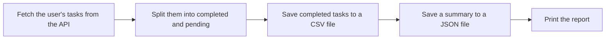

# Building a Small API Program

Each skill so far has been practised on its own: calling an API, handling its errors, writing a CSV file and writing a JSON file. Real programs combine them. A program fetches data from an API, processes it and saves the results so they can be used later.

This topic builds one complete program, a **task report**, that does all of this.

## What the Program Does

The program creates a report of one user's tasks from JSONPlaceholder:



Each step is handled by its own function:

| Step | Function | What It Does |
| --- | --- | --- |
| **Fetch** | `get_tasks()` | Requests the user's tasks and handles any errors |
| **Process** | `split_tasks()` | Separates completed tasks from pending ones |
| **Save as CSV** | `save_to_csv()` | Writes each completed task's ID and title to a CSV file |
| **Save as JSON** | `save_summary()` | Writes the task counts to a JSON file |

Giving each step its own function keeps the program easy to read, test and change. If the report later needs a different file format, only one function changes.

## The Complete Program

Save this code as `task_report.py` in a project folder. Run it with the project's virtual environment active and `requests` installed. The program needs an internet connection.

```python
import csv
import json
import requests

BASE_URL = "https://jsonplaceholder.typicode.com/todos"


def get_tasks(user_id):
    """Fetch all tasks for one user. Return a list, or None if the request fails."""
    try:
        response = requests.get(BASE_URL, params={"userId": user_id}, timeout=10)
        response.raise_for_status()
        return response.json()
    except requests.exceptions.HTTPError:
        print("Error: the server returned status code", response.status_code)
    except requests.exceptions.Timeout:
        print("Error: the server took too long to respond")
    except requests.exceptions.ConnectionError:
        print("Error: could not connect to the server")
    except requests.exceptions.JSONDecodeError:
        print("Error: the response is not valid JSON")
    return None


def split_tasks(tasks):
    """Split tasks into two lists: completed and pending."""
    completed = []
    pending = []
    for task in tasks:
        if task["completed"]:
            completed.append(task)
        else:
            pending.append(task)
    return completed, pending


def save_to_csv(tasks, filename):
    """Save each task's ID and title to a CSV file."""
    with open(filename, "w", newline="", encoding="utf-8") as file:
        writer = csv.writer(file)
        writer.writerow(["id", "title"])
        for task in tasks:
            writer.writerow([task["id"], task["title"]])


def save_summary(user_id, completed, pending, filename):
    """Save a short summary of the tasks to a JSON file."""
    summary = {
        "user_id": user_id,
        "total_tasks": len(completed) + len(pending),
        "completed": len(completed),
        "pending": len(pending),
    }
    with open(filename, "w", encoding="utf-8") as file:
        json.dump(summary, file, indent=4)
    return summary


user_id = 1
tasks = get_tasks(user_id)

if tasks is None:
    print("Could not create the report.")
else:
    completed, pending = split_tasks(tasks)
    save_to_csv(completed, "completed_tasks.csv")
    summary = save_summary(user_id, completed, pending, "task_summary.json")

    print("Report for user", summary["user_id"])
    print("Total tasks:", summary["total_tasks"])
    print("Completed:", summary["completed"])
    print("Pending:", summary["pending"])
    print("Saved completed_tasks.csv and task_summary.json")
```

**Output:**

```
Report for user 1
Total tasks: 20
Completed: 11
Pending: 9
Saved completed_tasks.csv and task_summary.json
```

The program also creates two files in the current working directory.

**File: `completed_tasks.csv`** (first four lines)

```
id,title
4,et porro tempora
8,quo adipisci enim quam ut ab
10,illo est ratione doloremque quia maiores aut
```

**File: `task_summary.json`**

```json
{
    "user_id": 1,
    "total_tasks": 20,
    "completed": 11,
    "pending": 9
}
```

The sections below explain the program one part at a time.

## The Imports and the Base URL

```python
import csv
import json
import requests

BASE_URL = "https://jsonplaceholder.typicode.com/todos"
```

- `csv` and `json` are standard library modules, so they need no installation. `requests` is an external library.
- `BASE_URL` stores the API address once, so every function uses the same value.

> **A constant is a variable whose value is not meant to change while the program runs. By convention, its name is written in capital letters.**

Python does not stop a constant from being changed. The capital letters only tell other programmers that it should not be.

## Fetching the Tasks

```python
def get_tasks(user_id):
    """Fetch all tasks for one user. Return a list, or None if the request fails."""
    try:
        response = requests.get(BASE_URL, params={"userId": user_id}, timeout=10)
        response.raise_for_status()
        return response.json()
    except requests.exceptions.HTTPError:
        ...
    return None
```

- `params={"userId": user_id}` asks the API for only this user's tasks.
- `raise_for_status()` turns an error status code into an `HTTPError`.
- On success, the function returns the list of tasks. If any of the four errors occurs, it prints a message, and the final line returns `None`.

The string in triple quotes below each `def` line is a **docstring**. It describes what the function does and what it returns.

## Splitting the Tasks

```python
def split_tasks(tasks):
    """Split tasks into two lists: completed and pending."""
    completed = []
    pending = []
    for task in tasks:
        if task["completed"]:
            completed.append(task)
        else:
            pending.append(task)
    return completed, pending
```

- Each task is a dictionary, and `task["completed"]` is `True` or `False`.
- The loop adds each task to one of the two lists.
- `return completed, pending` returns both lists together as a **tuple**.

The caller unpacks the tuple into two variables in one line:

```python
completed, pending = split_tasks(tasks)
```

## Saving the Completed Tasks to CSV

```python
def save_to_csv(tasks, filename):
    """Save each task's ID and title to a CSV file."""
    with open(filename, "w", newline="", encoding="utf-8") as file:
        writer = csv.writer(file)
        writer.writerow(["id", "title"])
        for task in tasks:
            writer.writerow([task["id"], task["title"]])
```

- `newline=""` is used whenever a file is opened for the `csv` module.
- The first `writerow()` writes the **header row**, `id,title`.
- The loop writes one row for each task. Only the ID and title are saved, not every field.

## Saving the Summary to JSON

```python
def save_summary(user_id, completed, pending, filename):
    """Save a short summary of the tasks to a JSON file."""
    summary = {
        "user_id": user_id,
        "total_tasks": len(completed) + len(pending),
        "completed": len(completed),
        "pending": len(pending),
    }
    with open(filename, "w", encoding="utf-8") as file:
        json.dump(summary, file, indent=4)
    return summary
```

- The summary is a dictionary of counts, built with `len()`.
- `json.dump()` writes the dictionary to the file, and `indent=4` makes the file easy to read.
- The function also **returns** the summary, so the main part of the program can print it without opening the file again.

## The Main Part of the Program

```python
user_id = 1
tasks = get_tasks(user_id)

if tasks is None:
    print("Could not create the report.")
else:
    completed, pending = split_tasks(tasks)
    save_to_csv(completed, "completed_tasks.csv")
    summary = save_summary(user_id, completed, pending, "task_summary.json")
    ...
```

- `get_tasks()` returns either a list of tasks or `None`.
- `if tasks is None:` stops the program from processing data that never arrived. Without this check, `split_tasks(None)` would raise a `TypeError`.
- When the tasks arrive, the other three functions run in order, and the report is printed.

To create a report for a different user, change `user_id`. JSONPlaceholder has users `1` to `10`.

## When the Request Fails

If there is no internet connection, `get_tasks()` catches the `ConnectionError` and returns `None`:

**Output (with no internet connection):**

```
Error: could not connect to the server
Could not create the report.
```

The program ends with a clear message instead of a traceback, and no files are created.

## Points to Remember

- **Give each step its own function**, such as fetching, processing and saving.
- **Return `None` when a request fails**, and check for it before using the data.
- **Write constants in capital letters**, such as `BASE_URL`, so their purpose is clear.
- **A function can return two values** as a tuple, which the caller unpacks into two variables.

## Further Reading

- 📎 **Official `requests` quickstart guide** — https://requests.readthedocs.io/en/latest/user/quickstart/
- 📎 **Official Python reference for the `csv` module** — https://docs.python.org/3/library/csv.html
- 📎 **Official Python reference for the `json` module** — https://docs.python.org/3/library/json.html

The CSV file this program creates is a small table of data. In the next topic, **Introduction to pandas**, you'll learn how to load, filter and summarise tables like this with far less code.
