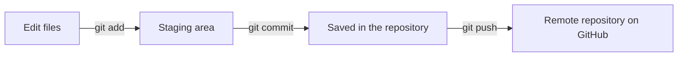

# Git Fundamentals

Code changes constantly while a program is being built. Without a system to track those changes, programmers end up with copies such as `calculator_final.py` and `calculator_final_v2.py`, and nobody knows which one is correct or how to go back to a version that worked. Professional programmers solve this with **version control**.

> **Version control is a system that records changes to a set of files over time, so that any earlier version can be viewed or restored later.**

> **Git is a free and open-source version control system. It records the history of a project's files, so programmers can track every change and return to an earlier version when needed.**

> **GitHub is a website that stores Git repositories online. It lets programmers back up their code and share it with others.**

Git runs on your computer. GitHub stores a copy of your work online.

## Key Terms

| Term | Meaning |
| --- | --- |
| **Repository** | A project folder that Git is tracking, together with the history of its changes. Often called a **repo** |
| **Commit** | A saved snapshot of the changes selected in the staging area, along with information about who made the commit and a message describing the changes |
| **Staging area** | The list of changes selected to be saved in the next commit |
| **Remote repository** | A copy of the repository stored online, such as on GitHub |
| **Branch** | A separate line of work in a repository, so changes can be made without affecting the main code |

## How Git Saves Changes

Saving changes in your local Git repository takes **two steps**. Sharing those commits with GitHub requires an **additional step**:



1. **`git add`** selects the changes to save.
2. **`git commit`** saves them as a snapshot on your computer.
3. **`git push`** sends your commits to the remote repository on GitHub.

The rest of this topic follows these steps in order.

## Step 1: Install Git

Git commands are typed into the **terminal**.

**On Windows:**

1. Open https://git-scm.com/downloads in your browser.
2. Click **Windows** and download the installer.
3. Run the installer and click **Next** on every screen to keep the default options.
4. Open a **new** Command Prompt or PowerShell window.

**On macOS:**

1. Open Terminal.
2. Run `xcode-select --install` and follow the instructions on the screen.

**On Linux (Ubuntu):**

1. Open Terminal.
2. Run `sudo apt install git`.

**Check the installation** on any system by running:

```
git --version
```

**Possible output:**

```
git version 2.43.0
```

If a version number is shown, Git is installed. Your version may be different.

## Step 2: Configure Git

Every commit records **who** made it. Run these three commands **once** on your computer, replacing the name and email with your own:

```
git config --global user.name "Ravi Kumar"
git config --global user.email "ravi@example.com"
git config --global init.defaultBranch main
```

- **`user.name`** and **`user.email`** identify the author of each commit. Use a name and an email address you want associated with your commits.
- **`init.defaultBranch main`** names the main branch of every new repository `main`.
- **`--global`** applies these settings to every repository on your computer.

## Step 3: Create a Repository

Open a terminal inside your project folder, such as `calculator_project`, which contains a file named `calculator.py`. Then run:

```
git init
```

**Possible output:**

```
Initialized empty Git repository in /home/ravi/calculator_project/.git/
```

**`git init`** turns the folder into a Git repository. It creates a hidden folder named **`.git`**, where Git stores the project's history. **Do not edit or delete the `.git` folder.**

## Step 4: Check the Status

```
git status
```

**Output:**

```
On branch main

No commits yet

Untracked files:
  (use "git add <file>..." to include in what will be committed)
    calculator.py
```

**`git status`** shows the state of your files. Here, `calculator.py` is **untracked**: Git sees the file, but is not saving it yet.

Run `git status` whenever you are unsure what has changed.

## Step 5: Stage the Changes

```
git add calculator.py
```

**`git add`** selects the file's changes and places them in the **staging area**, ready to be saved in the next commit. Running `git status` again now lists `calculator.py` under **Changes to be committed**.

| Command | What It Stages |
| --- | --- |
| `git add calculator.py` | Only the named file |
| `git add .` | All new, modified and deleted files under the current folder, except files ignored by Git |

### Files That Should Not Be Saved

Before staging all project files with `git add .`, decide which files should stay out of the repository, such as the `venv` folder and log files. Create a file named **`.gitignore`** in the project folder, listing them:

```
venv/
__pycache__/
*.log
```

Git ignores matching files that are **not already tracked**. This prevents files such as virtual environments, cache files and logs from being added accidentally. `*.log` means every file ending in `.log`. Files already tracked by Git are not automatically removed from tracking when they are added to `.gitignore`.

## Step 6: Commit the Changes

```
git commit -m "Add add function"
```

**Possible output:**

```
[main (root-commit) 3c5e05b] Add add function
 1 file changed, 2 insertions(+)
 create mode 100644 calculator.py
```

**`git commit`** saves the staged changes as a **commit** on your computer.

- **`-m`** adds the **commit message**, written in quotes. It should say clearly what the commit does, such as `Add add function` or `Fix pass mark check`.
- **`3c5e05b`** is the start of the commit's unique ID. Yours will be different.
- **`1 file changed, 2 insertions(+)`** shows that two lines were added.

Each time you make more changes, repeat Steps 4 to 6: check, stage and commit.

## Step 7: Connect to a Remote Repository

Your commits are saved only on your computer so far. To store them online, connect the repository to **GitHub**.

### Create a Repository on GitHub

1. Create a free account at https://github.com.
2. Click the **+** button at the top right, then **New repository**.
3. Enter a **Repository name**, such as `calculator_project`.
4. Leave **Add a README file** unticked, because your project already has its own files.
5. Click **Create repository**.

GitHub then shows the repository's **URL**, such as:

```
https://github.com/ravikumar/calculator_project.git
```

### Connect Your Repository to GitHub

In the terminal, inside your project folder, run the following, using **your own** repository URL:

```
git remote add origin https://github.com/ravikumar/calculator_project.git
```

- **`git remote add`** connects your local repository to a remote repository.
- **`origin`** is the name given to the remote. `origin` is the standard name used for the main remote.

To check the connection, run:

```
git remote -v
```

**Possible output:**

```
origin    https://github.com/ravikumar/calculator_project.git (fetch)
origin    https://github.com/ravikumar/calculator_project.git (push)
```

This confirms that `origin` points to your GitHub repository.

## Step 8: Push to GitHub

```
git push -u origin main
```

**`git push`** sends your commits from your computer to the remote repository.

- **`origin`** is the remote to send to.
- **`main`** is the branch to send.
- **`-u`** links your local `main` branch to `main` on GitHub. After this first push, you can simply run **`git push`**.

The first time you push, Git asks you to **sign in to GitHub**:

- Git may open a **browser window** so you can sign in to GitHub and authorise access.
- If Git asks for a **password** when using HTTPS, GitHub does **not** accept your account password. Use a **personal access token (PAT)** instead. You can create one on GitHub under **Settings → Developer settings → Personal access tokens**.

**Possible output (shortened):**

```
To https://github.com/ravikumar/calculator_project.git
 * [new branch]      main -> main
branch 'main' set up to track 'origin/main'.
```

Refresh the repository page on GitHub, and your files appear there.

## Working with Branches

A **branch** is a separate line of development. It lets you make changes without changing the code currently saved on another branch, such as `main`. When the change is ready, it can be added back to `main`.

### List the Branches

```
git branch
```

**Output:**

```
* main
```

The `*` marks the branch you are currently on.

### Create a Branch and Switch to It

```
git switch -c add-subtract
```

**Output:**

```
Switched to a new branch 'add-subtract'
```

**`git switch -c`** **creates** a new branch named `add-subtract` and **switches** to it. Branch names should describe the work, and use hyphens instead of spaces.

Running `git branch` now shows:

```
* add-subtract
  main
```

Any commits you make now are saved on `add-subtract`, not on `main`. For example, add a `subtract()` function to `calculator.py`, then stage and commit it:

```
git add calculator.py
git commit -m "Add subtract function"
```

### Push the Branch to GitHub

```
git push -u origin add-subtract
```

This sends the new branch and its commits to GitHub, just as Step 8 did for `main`.

### Switch Back to Another Branch

```
git switch main
```

**Output:**

```
Switched to branch 'main'
```

**`git switch`**, without `-c`, moves to a branch that **already exists**. On `main`, the `subtract()` function is not there, because it was committed on `add-subtract` only.

## The Everyday Workflow

Once Git and GitHub are set up, daily work follows the same commands, in this order:

1. **`git status`**: see what has changed.
2. **`git add .`**: stage the changes.
3. **`git commit -m "message"`**: save them as a commit.
4. **`git push`**: send the commits to GitHub.

## Command Summary

| Command | What It Does |
| --- | --- |
| `git --version` | Checks that Git is installed |
| `git config --global user.name "Name"` | Sets the name saved with your commits |
| `git init` | Creates a repository in the current folder |
| `git status` | Shows which files are untracked, changed or staged |
| `git add .` | Stages all new, modified and deleted files under the current folder, except ignored files |
| `git commit -m "message"` | Saves the staged changes as a commit |
| `git remote add origin <url>` | Connects the repository to GitHub |
| `git push -u origin main` | Sends commits to GitHub for the first time |
| `git push` | Sends new commits to GitHub |
| `git branch` | Lists the branches |
| `git switch -c <name>` | Creates a new branch and switches to it |
| `git switch <name>` | Switches to an existing branch |

## Points to Remember

- **Save work locally** using `git add` and `git commit`. Use **`git push`** to share those commits with GitHub.
- **Connect to GitHub once** with `git remote add origin <url>`, then push with `git push -u origin main`.
- **Use a branch** for new work with `git switch -c <name>`, and switch between branches with `git switch <name>`.
- **Run `git status` often**, and use `.gitignore` to keep files such as `venv/` out of the repository.

## Further Reading

- 📎 **Official Git downloads** — https://git-scm.com/downloads
- 📎 **GitHub guide to creating a repository** — https://docs.github.com/en/repositories/creating-and-managing-repositories/creating-a-new-repository

Your code is now on GitHub. But when other developers make changes to the same repository, you also need to bring those changes into your local copy. In the next topic, **Working with Remote Repositories**, you'll learn how to clone a repository and pull the latest changes from GitHub.
